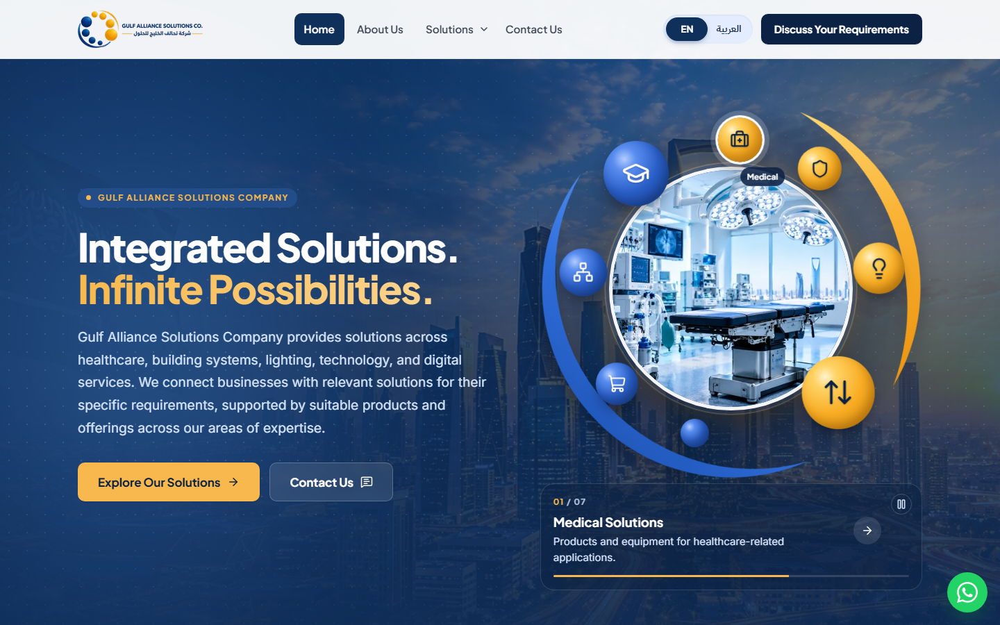
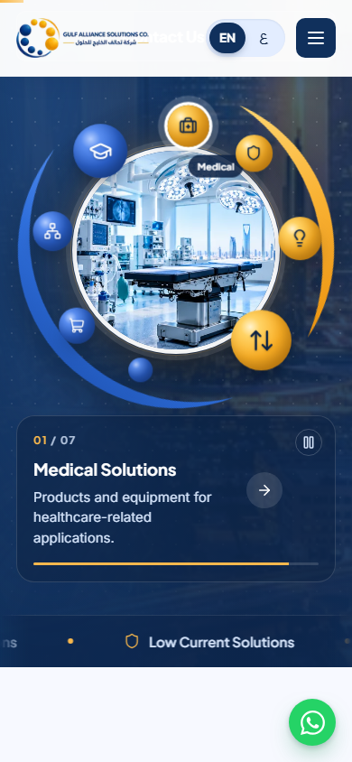

# Archived design — Home hero "logo orbit"

Archived on 2026-10-23, when the Home hero was replaced by a full-bleed photo
hero. Everything needed to bring this version back is in this file.

| Desktop | Mobile |
| --- | --- |
|  |  |

## What it was

- Navy hero over the dark skyline photo (`saudi-skyline.png`) with a slow zoom.
- Left: company-name pill, two-line headline (second line gold), intro text,
  "Explore Our Solutions" (gold) and "Contact Us" buttons.
- Right: the company **logo mark, slowly turning** — eight glossy spheres (four
  blue growing up the left, four gold growing round the right) inside the two
  crescent swooshes, traced from `src/assets/brand/logo-mark.png`. Seven spheres
  carry the solution icons (the smallest blue one is decorative); icons stay
  upright while the mark turns.
- The centre of the mark shows each solution's hero photo in a white-rimmed
  circle; the photo, the caption card below (number, name, summary, link) and
  the highlighted sphere step to the next solution every 4.6 s, with a gold
  progress bar. Click a sphere to jump; hover / keyboard focus pauses; a
  pause/play button; nothing moves with "reduce motion".
- Bottom edge: a ticker of all solution names scrolling sideways.

## How to restore it

1. Replace `src/components/sections/home/HomeHero.astro` with the source below.
2. Make sure these still exist (they were left in place when this was archived):
   - `ORBIT_FOCUS` and `SOLUTION_HERO_PHOTOS` in `src/data/media.ts`
     (`PHOTOS.homeHero` must point to the dark skyline backdrop:
     `saudi-skyline.png`)
   - `UI.hero` (`orbitLabel`, `pause`, `play`) in `src/data/en/site.ts` and
     `src/data/ar/site.ts`
   - the `pause`, `play` and `arrow-right` icons in `src/components/ui/icons.ts`
3. `npm run build` and check the Home page in both languages.

## Related data (as it was)

`src/data/media.ts`

```ts
/**
 * Horizontal focal point for each hero photo inside the round frame of the
 * Home hero orbit (a square crop of a wide photo), so the subject — signage,
 * people, equipment — sits in the middle of the circle.
 */
export const ORBIT_FOCUS: Record<SolutionSlug, string> = {
  medical: '57% 50%',
  'low-current': '44% 50%',
  lighting: '24% 50%',
  'electric-elevator': '36% 50%',
  'e-commerce': '27% 50%',
  it: '52% 50%',
  josoorkom: '50% 50%',
};
```

`src/data/en/site.ts` → `UI`

```ts
  hero: {
    orbitLabel: 'Our solution areas',
    pause: 'Pause animation',
    play: 'Play animation',
  },
```

`src/data/ar/site.ts` → `UI`

```ts
  hero: {
    orbitLabel: 'مجالات حلولنا',
    pause: 'إيقاف الحركة',
    play: 'تشغيل الحركة',
  },
```

## Full source — `src/components/sections/home/HomeHero.astro`

```astro
---
/**
 * Home hero — an animated "solution orbit" drawn like the company logo:
 * - full-bleed skyline photo under a navy gradient (slow zoom)
 * - headline, intro and buttons
 * - the logo mark, slowly turning: a ring of glossy spheres (blue ones growing
 *   up the left, gold ones growing round the right) inside two tapered
 *   crescent swooshes. Seven spheres carry a solution icon; the centre photo,
 *   the caption card and the highlighted sphere step through them every few
 *   seconds (click a sphere to jump; hover/focus pauses; pause button)
 * - a ticker of all solutions scrolling along the bottom edge
 * Reduced motion: nothing moves, spheres still switch the photo on click.
 */
import { Image } from 'astro:assets';
import Button from '@/components/ui/Button.astro';
import Eyebrow from '@/components/ui/Eyebrow.astro';
import Icon from '@/components/ui/Icon.astro';
import { getContent } from '@/data';
import { focusOf, ORBIT_FOCUS, PHOTOS, SOLUTION_HERO_PHOTOS } from '@/data/media';
import DarkBackdrop from '@/components/sections/shared/DarkBackdrop.astro';

const { brand, home, solutions, ui, R } = getContent(Astro.url);
const { hero } = home;
const [lineA, lineB] = hero.titleLines;
const total = String(solutions.length).padStart(2, '0');
const pad = (i: number) => String(i + 1).padStart(2, '0');
const bgFocus = focusOf(PHOTOS.homeHero);

/*
 * Sphere layout traced from the logo mark (src/assets/brand/logo-mark.png):
 * angle clockwise from 12 o'clock, diameter as % of the orbit. The smallest
 * blue sphere is decorative; the other seven hold the solutions in order.
 */
const SPHERES = [
  { angle: 344, size: 10, tone: 'gold' },
  { angle: 17, size: 11.5, tone: 'gold' },
  { angle: 63, size: 13.5, tone: 'gold' },
  { angle: 115, size: 19, tone: 'gold' },
  { angle: 175, size: 7.5, tone: 'blue', decorative: true },
  { angle: 211, size: 11, tone: 'blue' },
  { angle: 257, size: 12.5, tone: 'blue' },
  { angle: 301, size: 17, tone: 'blue' },
] as const;
let next = 0;
const spheres = SPHERES.map((sphere) => ({ ...sphere, index: 'decorative' in sphere ? -1 : next++ }));

/** Point on a circle round the centre of a 100×100 box, angle clockwise from 12 o'clock. */
const point = (angle: number, radius: number) => {
  const rad = (angle * Math.PI) / 180;
  return `${(50 + radius * Math.sin(rad)).toFixed(2)} ${(50 - radius * Math.cos(rad)).toFixed(2)}`;
};
/** Logo swoosh: outer arc from → to (clockwise), back along a flatter arc so it tapers at both tips. */
const crescent = (from: number, to: number, outer: number, thickness: number) => {
  const span = (to - from + 360) % 360;
  const half = ((span / 2) * Math.PI) / 180;
  const chord = outer * Math.sin(half);
  const sagitta = outer - thickness - outer * Math.cos(half);
  const inner = ((chord * chord + sagitta * sagitta) / (2 * sagitta)).toFixed(2);
  return `M${point(from, outer)}A${outer} ${outer} 0 ${span > 180 ? 1 : 0} 1 ${point(to, outer)}A${inner} ${inner} 0 0 0 ${point(from, outer)}Z`;
};
const swooshBlue = crescent(137, 288, 49.5, 5);
const swooshGold = crescent(2, 102, 49.5, 4.2);
---

<section class="hero" data-tone="dark" aria-labelledby="hero-title">
  <div class="hero__bg" aria-hidden="true">
    <Image
      src={PHOTOS.homeHero}
      alt=""
      widths={[960, 1440, 1672]}
      sizes="(min-width: 1000px) 125vw, 200vw"
      loading="eager"
      fetchpriority="high"
      class="hero__bg-img"
      style={bgFocus ? `object-position:${bgFocus}` : undefined}
    />
  </div>
  <DarkBackdrop grid arcs={false} />

  <div class="container hero__inner">
    <div class="hero__content">
      <Eyebrow variant="pill" class="hero__anim">{brand.name}</Eyebrow>
      <h1 id="hero-title" class="hero__title hero__anim">
        <span>{lineA}</span> <span class="hero__accent">{lineB}</span>
      </h1>
      <p class="hero__text hero__anim">{hero.text}</p>
      <div class="hero__actions hero__anim">
        <Button href={hero.ctas[0].href} variant="gold" size="lg">{hero.ctas[0].label}</Button>
        <Button href={hero.ctas[1].href} variant="navy-soft" size="lg" icon="message-square-text">{hero.ctas[1].label}</Button>
      </div>
    </div>

    <div class="orbit hero__anim" data-orbit role="group" aria-label={ui.hero.orbitLabel}>
      <div class="orbit__stage">
        <span class="orbit__halo" aria-hidden="true"></span>

        <div class="orbit__core" aria-hidden="true">
          {
            solutions.map((s, i) => {
              const photo = SOLUTION_HERO_PHOTOS[s.slug];
              return (
                <div class:list={['orbit__slide', { 'is-active': i === 0 }]} data-orbit-slide>
                  <Image
                    src={photo}
                    alt=""
                    widths={[720, 960, 1280, 1672]}
                    sizes="(min-width: 1000px) 680px, (min-width: 560px) 560px, 110vw"
                    quality={85}
                    loading={i === 0 ? 'eager' : 'lazy'}
                    class="orbit__img"
                    style={`object-position:${ORBIT_FOCUS[s.slug]}`}
                  />
                </div>
              );
            })
          }
        </div>

        <div class="orbit__spin">
          <svg class="orbit__swoosh" viewBox="0 0 100 100" aria-hidden="true" focusable="false">
            <defs>
              <linearGradient id="swoosh-blue" x1="0" y1="1" x2="0.4" y2="0">
                <stop offset="0" stop-color="#1c4fae" />
                <stop offset="0.55" stop-color="#2f6fdc" />
                <stop offset="1" stop-color="#5b93f0" />
              </linearGradient>
              <linearGradient id="swoosh-gold" x1="0" y1="0" x2="1" y2="1">
                <stop offset="0" stop-color="#ffd772" />
                <stop offset="0.5" stop-color="#f9b234" />
                <stop offset="1" stop-color="#ec9410" />
              </linearGradient>
            </defs>
            <path d={swooshBlue} fill="url(#swoosh-blue)" />
            <path d={swooshGold} fill="url(#swoosh-gold)" />
          </svg>

          <ul class="orbit__track">
            {
              spheres.map((sphere) => {
                const s = solutions[sphere.index];
                const style = `--angle:${sphere.angle}deg;--size:${sphere.size}`;
                return s ? (
                  <li class:list={['orbit__node', `orbit__node--${sphere.tone}`]} style={style}>
                    <button type="button" class:list={['orbit__btn', { 'is-active': sphere.index === 0 }]} data-orbit-node={sphere.index} aria-pressed={sphere.index === 0 ? 'true' : 'false'}>
                      <span class="orbit__sphere">
                        <Icon name={s.icon} size={24} strokeWidth={1.9} />
                      </span>
                      <span class="orbit__label">{s.shortName}</span>
                      <span class="visually-hidden">{s.name}</span>
                    </button>
                  </li>
                ) : (
                  <li class:list={['orbit__node', `orbit__node--${sphere.tone}`, 'orbit__node--decor']} style={style} aria-hidden="true">
                    <span class="orbit__btn"><span class="orbit__sphere"></span></span>
                  </li>
                );
              })
            }
          </ul>
        </div>
      </div>

      <div class="orbit__caption">
        <div class="orbit__cards">
          {
            solutions.map((s, i) => (
              <a href={R.solution(s.slug)} class:list={['orbit__card', { 'is-active': i === 0 }]} data-orbit-card inert={i === 0 ? undefined : true}>
                <span class="orbit__count">
                  {pad(i)} <span>/ {total}</span>
                </span>
                <span class="orbit__name">{s.name}</span>
                <span class="orbit__summary">{s.summary}</span>
                <span class="orbit__go" aria-hidden="true"><Icon name="arrow-right" size={18} strokeWidth={2.2} class="icon-dir" /></span>
              </a>
            ))
          }
        </div>
        <div class="orbit__bar" aria-hidden="true"><span data-orbit-progress></span></div>
        <button type="button" class="orbit__pause" data-orbit-pause aria-pressed="false" data-label-pause={ui.hero.pause} data-label-play={ui.hero.play}>
          <Icon name="pause" size={16} strokeWidth={2.4} class="orbit__pause-icon" />
          <Icon name="play" size={16} strokeWidth={2.4} class="orbit__play-icon" />
          <span class="visually-hidden" data-orbit-pause-label>{ui.hero.pause}</span>
        </button>
      </div>
    </div>
  </div>

  <div class="ticker" aria-hidden="true">
    <div class="ticker__track">
      {
        [0, 1].map(() => (
          <ul class="ticker__list">
            {solutions.map((s) => (
              <li>
                <Icon name={s.icon} size={18} strokeWidth={1.8} />
                {s.name}
              </li>
            ))}
          </ul>
        ))
      }
    </div>
  </div>
</section>

<script>
  import { prefersReducedMotion } from '@/scripts/env';

  const root = document.querySelector<HTMLElement>('[data-orbit]');
  if (root) {
    const nodes = [...root.querySelectorAll<HTMLButtonElement>('[data-orbit-node]')];
    const slides = [...root.querySelectorAll<HTMLElement>('[data-orbit-slide]')];
    const cards = [...root.querySelectorAll<HTMLAnchorElement>('[data-orbit-card]')];
    const progress = root.querySelector<HTMLElement>('[data-orbit-progress]')!;
    const pauseBtn = root.querySelector<HTMLButtonElement>('[data-orbit-pause]')!;
    const pauseLabel = root.querySelector<HTMLElement>('[data-orbit-pause-label]')!;
    let index = 0;
    let userPaused = false;
    let hovering = false;
    let focused = false;
    let offscreen = false;

    const syncPaused = () => {
      root.classList.toggle('is-paused', userPaused || hovering || focused || offscreen);
    };

    // The progress bar's CSS animation is the timer: when it ends, advance.
    const restart = () => {
      if (prefersReducedMotion) return;
      progress.classList.remove('is-running');
      void progress.offsetWidth;
      progress.classList.add('is-running');
    };

    const show = (next: number) => {
      index = (next + nodes.length) % nodes.length;
      nodes.forEach((n, i) => {
        n.classList.toggle('is-active', i === index);
        n.setAttribute('aria-pressed', String(i === index));
      });
      slides.forEach((s, i) => s.classList.toggle('is-active', i === index));
      cards.forEach((c, i) => {
        c.classList.toggle('is-active', i === index);
        c.inert = i !== index;
      });
      restart();
    };

    nodes.forEach((node, i) => node.addEventListener('click', () => show(i)));
    progress.addEventListener('animationend', () => show(index + 1));

    pauseBtn.addEventListener('click', () => {
      userPaused = !userPaused;
      pauseBtn.setAttribute('aria-pressed', String(userPaused));
      pauseLabel.textContent = (userPaused ? pauseBtn.dataset.labelPlay : pauseBtn.dataset.labelPause) ?? '';
      syncPaused();
    });

    // Pause while the visitor is looking at (hovering) or tabbing through the orbit.
    const stage = root.querySelector<HTMLElement>('.orbit__stage')!;
    stage.addEventListener('pointerenter', (e) => {
      hovering = e.pointerType === 'mouse';
      syncPaused();
    });
    stage.addEventListener('pointerleave', () => {
      hovering = false;
      syncPaused();
    });
    root.addEventListener('focusin', () => {
      focused = root.matches(':has(:focus-visible)');
      syncPaused();
    });
    root.addEventListener('focusout', (e) => {
      if (root.contains(e.relatedTarget as Node | null)) return;
      focused = false;
      syncPaused();
    });

    if ('IntersectionObserver' in window) {
      new IntersectionObserver(([entry]) => {
        offscreen = !entry.isIntersecting;
        syncPaused();
      }).observe(root);
    }

    if (prefersReducedMotion) root.classList.add('is-static');
    else restart();
  }
</script>

<style>
  .hero {
    position: relative;
    isolation: isolate;
    overflow: hidden;
    display: flex;
    flex-direction: column;
    min-height: min(100svh, 940px);
    padding-top: calc(var(--header-h) + clamp(28px, 4vw, 56px));
    background: var(--color-navy-900);
  }

  /* Backdrop photo + gradient ---------------------------------------------------- */
  .hero__bg { position: absolute; inset: 0; z-index: -2; }
  .hero__bg :global(.hero__bg-img) {
    width: 100%;
    height: 100%;
    object-fit: cover;
    animation: hero-zoom 26s var(--ease) both;
  }
  .hero__bg::after {
    content: '';
    position: absolute;
    inset: 0;
    background:
      linear-gradient(90deg, rgb(16 48 92 / 0.97) 0%, rgb(16 48 92 / 0.9) 36%, rgb(16 48 92 / 0.62) 68%, rgb(16 48 92 / 0.72) 100%),
      linear-gradient(180deg, rgb(16 48 92 / 0.25) 0%, transparent 35%, rgb(12 34 68 / 0.9) 100%);
  }
  :global([dir='rtl']) .hero__bg::after {
    background:
      linear-gradient(270deg, rgb(16 48 92 / 0.97) 0%, rgb(16 48 92 / 0.9) 36%, rgb(16 48 92 / 0.62) 68%, rgb(16 48 92 / 0.72) 100%),
      linear-gradient(180deg, rgb(16 48 92 / 0.25) 0%, transparent 35%, rgb(12 34 68 / 0.9) 100%);
  }

  .hero__inner {
    flex: 1;
    display: grid;
    grid-template-columns: minmax(0, 1.05fr) minmax(0, 0.95fr);
    align-items: center;
    gap: clamp(32px, 4vw, 64px);
    padding-bottom: clamp(36px, 4vw, 56px);
  }
  .hero__content { max-width: 680px; }
  .hero__title { margin-top: 12px; font-size: clamp(2.3rem, 1.35rem + 2.9vw, 3.55rem); line-height: 1.06; letter-spacing: -0.035em; color: #fff; }
  .hero__title span { display: block; }
  .hero__accent {
    background: linear-gradient(90deg, var(--color-gold-500), var(--color-gold-300));
    -webkit-background-clip: text;
    background-clip: text;
    color: transparent;
  }
  .hero__text { margin-top: 24px; max-width: 58ch; font-size: var(--fs-lead); line-height: 1.7; color: var(--color-blue-300); }
  .hero__actions { display: flex; flex-wrap: wrap; gap: 14px; margin-top: 34px; }

  /* Orbit — the logo mark ---------------------------------------------------------- */
  .orbit {
    --spin: 70s;
    position: relative;
    width: min(100%, 560px);
    margin-inline: auto;
  }
  .orbit__stage { position: relative; aspect-ratio: 1; container-type: inline-size; }
  .orbit__stage::before {
    /* soft dark disc so the mark reads clearly over the photo */
    content: '';
    position: absolute;
    inset: 0;
    border-radius: 50%;
    background: radial-gradient(closest-side, rgb(12 34 68 / 0.8), rgb(12 34 68 / 0.4) 72%, transparent);
  }
  .orbit__halo {
    position: absolute;
    inset: 17%;
    border: 1px solid rgb(248 184 77 / 0.4);
    border-radius: 50%;
    box-shadow: 0 0 50px -4px rgb(248 184 77 / 0.35);
    pointer-events: none;
  }

  .orbit__core {
    position: absolute;
    inset: 19%;
    overflow: hidden;
    border-radius: 50%;
    background: var(--color-navy-800);
    box-shadow:
      0 0 0 5px rgb(255 255 255 / 0.95),
      0 0 0 12px rgb(255 255 255 / 0.1),
      0 34px 70px -24px rgb(0 0 0 / 0.75);
  }
  .orbit__slide {
    position: absolute;
    inset: 0;
    opacity: 0;
    transform: scale(1.06);
    transition: opacity 0.9s var(--ease), transform 5s var(--ease);
  }
  .orbit__slide.is-active { opacity: 1; transform: scale(1); }
  .orbit__slide :global(.orbit__img) { width: 100%; height: 100%; object-fit: cover; }
  .orbit__core::after {
    content: '';
    position: absolute;
    inset: 0;
    border-radius: inherit;
    background: radial-gradient(circle at 50% 35%, transparent 72%, rgb(12 34 68 / 0.22) 100%);
  }

  /* The swooshes and spheres turn together, like the logo spinning. */
  .orbit__spin {
    position: absolute;
    inset: 0;
    animation: orbit-spin var(--spin) linear infinite;
  }
  .orbit__swoosh {
    position: absolute;
    inset: 0;
    width: 100%;
    height: 100%;
    overflow: visible;
    filter: drop-shadow(0 8px 16px rgb(0 0 0 / 0.35));
  }
  .orbit__track { position: absolute; inset: 0; margin: 0; padding: 0; list-style: none; }
  .orbit__node {
    /* diameter from the logo proportions, never smaller than a comfortable tap target */
    --d: max(calc(var(--size) * 1cqi), 40px);
    position: absolute;
    top: 50%;
    left: 50%;
    width: var(--d);
    height: var(--d);
    margin: calc(var(--d) / -2) 0 0 calc(var(--d) / -2);
    transform: rotate(var(--angle)) translateY(-39cqi) rotate(calc(var(--angle) * -1));
  }
  .orbit__node--decor { --d: calc(var(--size) * 1cqi); }
  .orbit__btn {
    position: relative;
    display: block;
    width: 100%;
    height: 100%;
    padding: 0;
    border: 0;
    border-radius: 50%;
    background: none;
    cursor: pointer;
    /* counter-rotation keeps the icons upright while the mark turns */
    animation: orbit-spin var(--spin) linear infinite reverse;
  }
  .orbit__node--decor .orbit__btn { cursor: default; }
  .orbit__sphere {
    display: grid;
    place-items: center;
    width: 100%;
    height: 100%;
    border-radius: 50%;
    box-shadow: inset -0.35em -0.45em 0.8em rgb(0 0 0 / 0.22), 0 12px 24px -10px rgb(0 0 0 / 0.55);
    transition: transform 0.45s var(--ease), box-shadow 0.35s var(--ease);
  }
  .orbit__node--gold .orbit__sphere {
    background: radial-gradient(circle at 32% 28%, #fff3cf 0%, #ffd365 16%, #f9ad24 52%, #db8507 100%);
    color: var(--color-navy-950);
  }
  .orbit__node--blue .orbit__sphere {
    background: radial-gradient(circle at 32% 28%, #b3cdff 0%, #5a8ef0 18%, #2a5fc8 52%, #153f90 100%);
    color: #fff;
  }
  .orbit__sphere :global(svg) { width: 44%; height: 44%; filter: drop-shadow(0 1px 1px rgb(0 0 0 / 0.2)); }
  .orbit__btn:hover .orbit__sphere { transform: scale(1.08); }
  .orbit__btn.is-active .orbit__sphere {
    transform: scale(1.16);
    box-shadow:
      inset -0.35em -0.45em 0.8em rgb(0 0 0 / 0.18),
      0 0 0 3px #fff,
      0 0 0 9px rgb(255 255 255 / 0.18),
      0 16px 32px -10px rgb(0 0 0 / 0.6);
  }
  .orbit__label {
    position: absolute;
    top: calc(100% + 12px);
    left: 50%;
    translate: -50% 0;
    padding: 4px 10px;
    border-radius: var(--radius-pill);
    background: rgb(12 34 68 / 0.88);
    font-family: var(--font-display);
    font-size: 0.72rem;
    font-weight: 700;
    color: #fff;
    white-space: nowrap;
    opacity: 0;
    transform: translateY(-4px);
    transition: opacity 0.3s var(--ease), transform 0.3s var(--ease);
    pointer-events: none;
  }
  .orbit__btn.is-active .orbit__label,
  .orbit__btn:hover .orbit__label { opacity: 1; transform: none; }

  .orbit.is-paused .orbit__spin,
  .orbit.is-paused .orbit__btn,
  .orbit.is-paused [data-orbit-progress] { animation-play-state: paused; }
  .orbit.is-static .orbit__spin,
  .orbit.is-static .orbit__btn { animation: none; }
  .orbit.is-static .orbit__bar,
  .orbit.is-static .orbit__pause { display: none; }

  /* Caption card under the orbit */
  .orbit__caption {
    position: relative;
    margin-top: 6px;
    padding: 16px 18px 18px;
    border: 1px solid rgb(255 255 255 / 0.14);
    border-radius: var(--radius-lg);
    background: rgb(12 34 68 / 0.55);
    backdrop-filter: blur(12px);
    -webkit-backdrop-filter: blur(12px);
  }
  .orbit__cards { display: grid; }
  .orbit__card {
    grid-area: 1 / 1;
    display: grid;
    grid-template-columns: minmax(0, 1fr) auto;
    column-gap: 16px;
    align-items: center;
    padding-inline-end: 40px;
    opacity: 0;
    transform: translateY(10px);
    visibility: hidden;
    transition: opacity 0.5s var(--ease), transform 0.6s var(--ease), visibility 0s linear 0.5s;
  }
  .orbit__card.is-active { opacity: 1; transform: none; visibility: visible; transition-delay: 0.1s, 0.1s, 0s; }
  .orbit__count { grid-column: 1; font-family: var(--font-display); font-size: var(--fs-2xs); font-weight: 700; letter-spacing: 0.1em; color: var(--color-gold-500); }
  .orbit__count span { color: var(--color-blue-400); }
  .orbit__name { grid-column: 1; margin-top: 4px; font-family: var(--font-display); font-size: 1.15rem; font-weight: 700; color: #fff; }
  .orbit__summary { grid-column: 1; margin-top: 2px; font-size: var(--fs-small); line-height: 1.5; color: var(--color-blue-300); }
  .orbit__go {
    grid-column: 2;
    grid-row: 1 / span 3;
    display: grid;
    place-items: center;
    width: 40px;
    height: 40px;
    border-radius: 50%;
    background: rgb(255 255 255 / 0.12);
    color: #fff;
    transition: background-color 0.25s, color 0.25s;
  }
  .orbit__card:hover .orbit__go { background: var(--color-gold-500); color: var(--color-navy-950); }
  .orbit__bar { margin-top: 14px; height: 3px; overflow: hidden; border-radius: 3px; background: rgb(255 255 255 / 0.14); }
  .orbit__bar span { display: block; height: 100%; background: var(--color-gold-500); transform: scaleX(0); transform-origin: 0 50%; }
  :global([dir='rtl']) .orbit__bar span { transform-origin: 100% 50%; }
  .orbit__bar span:global(.is-running) { animation: orbit-progress 4.6s linear forwards; }
  .orbit__pause {
    position: absolute;
    top: 14px;
    inset-inline-end: 14px;
    display: grid;
    place-items: center;
    width: 30px;
    height: 30px;
    padding: 0;
    border: 1px solid rgb(255 255 255 / 0.2);
    border-radius: 50%;
    background: transparent;
    color: var(--color-blue-300);
    cursor: pointer;
  }
  .orbit__pause:hover { color: #fff; border-color: rgb(255 255 255 / 0.4); }
  .orbit__pause :global(.orbit__play-icon) { display: none; }
  .orbit__pause[aria-pressed='true'] :global(.orbit__play-icon) { display: block; }
  .orbit__pause[aria-pressed='true'] :global(.orbit__pause-icon) { display: none; }

  /* Ticker ------------------------------------------------------------------------ */
  .ticker {
    overflow: hidden;
    padding-block: 16px;
    border-top: 1px solid rgb(255 255 255 / 0.1);
    background: rgb(12 34 68 / 0.45);
    mask-image: linear-gradient(90deg, transparent, #000 8%, #000 92%, transparent);
  }
  .ticker__track { display: flex; width: max-content; animation: ticker 48s linear infinite; }
  :global([dir='rtl']) .ticker__track { animation-name: ticker-rtl; }
  .ticker:hover .ticker__track { animation-play-state: paused; }
  .ticker__list { display: flex; margin: 0; padding: 0; list-style: none; }
  .ticker__list li {
    display: inline-flex;
    align-items: center;
    gap: 10px;
    padding-inline: 28px;
    font-family: var(--font-display);
    font-size: 0.95rem;
    font-weight: 600;
    color: var(--color-blue-300);
    white-space: nowrap;
  }
  .ticker__list li::after { content: ''; width: 6px; height: 6px; margin-inline-start: 46px; border-radius: 50%; background: var(--color-gold-500); }
  .ticker__list li :global(svg) { color: var(--color-gold-500); }

  /* Entrance --------------------------------------------------------------------- */
  .hero :global(.hero__anim) { animation: hero-in 0.9s var(--ease) backwards; }
  .hero :global(.hero__title) { animation-delay: 0.08s; }
  .hero__text { animation-delay: 0.16s; }
  .hero__actions { animation-delay: 0.24s; }
  .orbit.hero__anim { animation: orbit-in 1.2s var(--ease) 0.2s backwards; }

  @keyframes hero-in { from { opacity: 0; transform: translateY(18px); } }
  @keyframes orbit-in { from { opacity: 0; transform: scale(0.9) rotate(-8deg); } }
  @keyframes hero-zoom { from { transform: scale(1.1); } }
  @keyframes orbit-spin { to { transform: rotate(360deg); } }
  @keyframes orbit-progress { to { transform: scaleX(1); } }
  @keyframes ticker { to { transform: translateX(-50%); } }
  @keyframes ticker-rtl { to { transform: translateX(50%); } }

  @media (max-width: 999px) {
    .hero__inner { grid-template-columns: minmax(0, 1fr); }
    .orbit { width: min(100%, 470px); }
  }
  @media (max-width: 559px) {
    .hero__actions :global(.btn) { flex: 1 1 100%; }
    .orbit__label { font-size: 0.66rem; }
  }
  @media (prefers-reduced-motion: reduce) {
    .ticker__track { animation: none; }
  }
</style>
```
